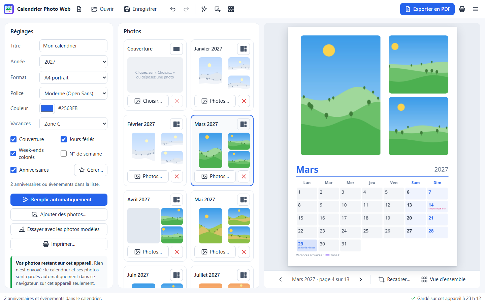
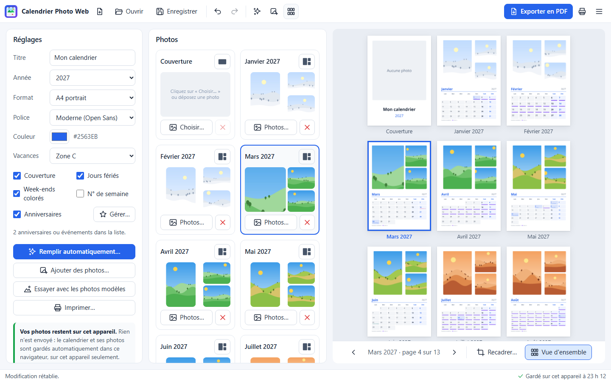
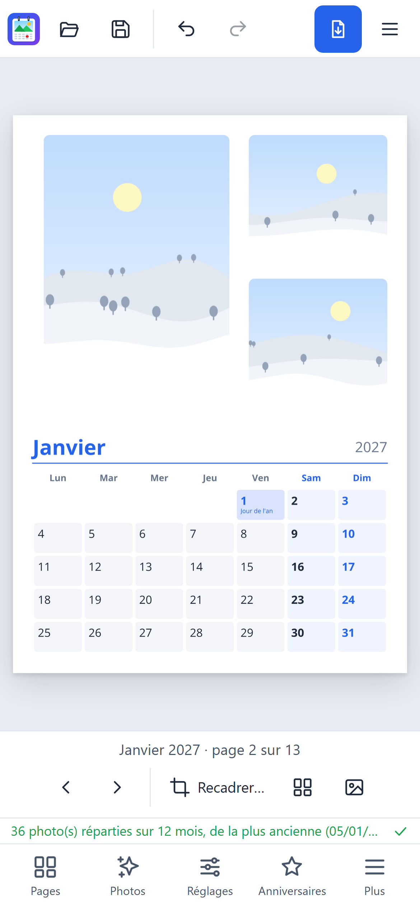
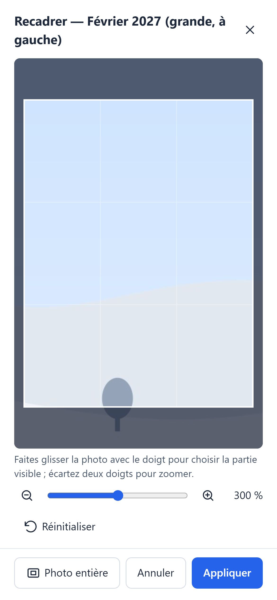
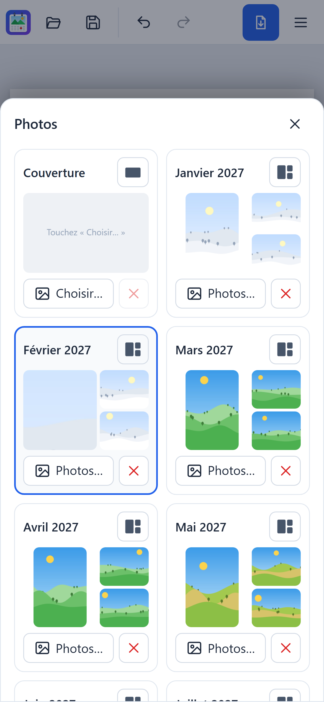

# Calendrier Photo Web

Créez un calendrier personnalisé avec vos photos, puis exportez-le en PDF prêt à imprimer — **entièrement dans votre
navigateur**, sur ordinateur, tablette ou téléphone. Une à quatre photos par mois, jours fériés et vacances scolaires
françaises, anniversaires et événements.

**Ouvrir le site : <https://yannickbuchet-ctrl.github.io/calendrier-photo-web/>**

C'est la version web de [Calendrier Photo](https://github.com/yannickbuchet-ctrl/calendrier-photo), l'application
pour Windows : mêmes pages, même remplissage automatique, mêmes fichiers d'anniversaires.



## Vos photos restent chez vous

- **Rien n'est envoyé.** Le site n'a pas de serveur qui reçoit vos photos : elles sont lues, recadrées et mises en
  page dans votre navigateur, et le PDF y est créé.
- **Aucune statistique, aucun traceur, aucune publicité.** Le site ne charge rien depuis un autre site (pas même une
  police de caractères), et sa politique de sécurité interdit d'envoyer des données ailleurs.
- **Sauvegarde automatique sur cet appareil.** Le calendrier en cours et ses photos sont gardés dans le stockage du
  navigateur (IndexedDB), sur cet appareil seulement. À la prochaine visite, le site propose de le reprendre. Le bouton
  « Données de cet appareil… » montre la place occupée et efface tout.
- **Hors ligne** : une fois le site ouvert une première fois, il fonctionne sans connexion (seuls les fichiers du site
  sont gardés par le service worker, jamais vos photos).

## Fonctions

- **Couverture et 12 mois**, au format A4 ou A3, en portrait ou en paysage.
- **Une à quatre photos par page** : une photo, deux côte à côte, une grande et deux petites, ou une mosaïque.
- **Remplissage automatique** : sélectionnez toutes vos photos ; elles sont classées par date de prise de vue (EXIF,
  ou date dans le nom du fichier, ou date du fichier) et la disposition de chaque page est choisie pour les utiliser
  toutes, portraits et paysages dans les cadres de leur format. Le calcul est celui de la version Windows : les mêmes
  photos donnent les mêmes pages.
- **Recadrage** de chaque photo : glisser à la souris ou au doigt, zoom à la molette, au curseur ou à deux doigts,
  flèches et +/− au clavier ; ou « Photo entière ».
- **Jours fériés** (France métropolitaine) et **vacances scolaires** des zones A, B et C (jusqu'à l'été 2028).
- **Numéros de semaine**, week-ends en couleur, trois polices (Moderne, Élégant, Manuscrit) et la couleur de votre
  choix.
- **Anniversaires et événements**, avec l'âge pour les anniversaires ; import et export CSV au même format que la
  version Windows (Date;Type;Description, ouvrable avec Excel).
- **Vue d'ensemble** des 13 pages, **annuler et rétablir** (Ctrl+Z, Ctrl+Y).
- Avertissement si une photo est **déjà utilisée** dans le calendrier (même sous un autre nom).
- **Export PDF** à 300 ppp et **impression** ; les cadres restés vides ne sont pas imprimés.
- Le **mode clair ou sombre** suit celui de l'appareil.

Pour essayer sans vos propres photos : « Essayer avec les photos modèles » remplit le calendrier avec 36 paysages
dessinés (aucune photo réelle), les mêmes que dans la version Windows.



### Sur téléphone et tablette

Sur un téléphone, l'aperçu de la page occupe l'écran ; glissez le doigt vers la gauche ou la droite pour changer de
page, touchez deux fois une photo pour la recadrer. Une barre en bas de l'écran ouvre le reste :

| Bouton | Rôle |
|---|---|
| Pages | les vignettes des 13 pages : disposition, choix et retrait des photos |
| Photos | remplir automatiquement, ajouter des photos, photos modèles |
| Réglages | titre, année, format, police, couleur, vacances, cases à cocher |
| Anniversaires | la liste des anniversaires et événements |
| Plus | nouveau, ouvrir, enregistrer, exporter, imprimer, vue d'ensemble, données de l'appareil |

Sur une tablette, un panneau (réglages ou photos des pages, au choix) reste à côté de l'aperçu.

<p>



</p>

### Le fichier de projet (.calendrier)

« Enregistrer » (Ctrl+S) crée un fichier `.calendrier` : une archive ZIP qui contient le projet
(`projet.calendrier.json`, au format des projets de la version Windows : réglages, dispositions, recadrages,
anniversaires) **et les photos** (dossier `photos/`, fichiers d'origine). Un navigateur ne peut pas retrouver une photo
par son emplacement sur l'ordinateur : le projet emporte donc ses photos, et se rouvre sur n'importe quel appareil.

- Une fois l'archive décompressée, `projet.calendrier.json` s'ouvre aussi dans la version Windows
  (« Importer un projet »), qui retrouve les photos à côté de lui.
- Un projet `.calendrier.json` de la version Windows s'ouvre ici : choisissez ensuite ses photos (toutes d'un coup),
  elles sont remises à leur place d'après leur nom.
- Avec Chrome et Edge, « Enregistrer » réécrit le même fichier ; ailleurs, le fichier est téléchargé.

### Raccourcis clavier

| Touches | Action |
|---|---|
| Ctrl+O, Ctrl+S, Ctrl+Maj+S | ouvrir, enregistrer, enregistrer sous |
| Ctrl+E, Ctrl+P | exporter en PDF, imprimer |
| Ctrl+I | ajouter des photos |
| Ctrl+Z, Ctrl+Y | annuler, rétablir |
| Page préc., Page suiv. (flèches dans l'aperçu) | page précédente, suivante |
| V | vue d'ensemble |

## Différences avec la version Windows

- **Polices.** Segoe UI, Georgia et Segoe Script sont des polices de Windows qu'un site ne peut ni utiliser partout ni
  intégrer à un PDF. Elles sont remplacées par des polices libres proches : **Open Sans** (Moderne), **Gelasio**
  (Élégant, aux mêmes mesures que Georgia) et **Kalam** (Manuscrit). La mise en page est la même (cases, marges,
  tailles), mais les lettres diffèrent un peu, et un texte long peut passer à la ligne à un autre endroit. Les émojis
  et les écritures que ces polices n'ont pas ne sont pas imprimés (une lettre accentuée absente devient sa lettre de
  base, par exemple « ł » → « l »).
- **Dimensions du PDF.** Les pages mesurent exactement 210 × 297 mm (A4) ou 297 × 420 mm (A3) ; la version Windows
  arrondit au point (595 × 842 pt), soit un dixième de millimètre de différence.
- **Photos à 300 ppp au plus.** Chaque photo est intégrée à sa taille d'impression, à 300 ppp ; une photo plus petite
  que son cadre n'est pas agrandie (sa résolution est alors plus faible).
- **Impression.** Le navigateur imprime une image de chaque page (200 ppp, 150 sur un appareil qui a peu de mémoire),
  à 100 %, sans marges. Pour la meilleure qualité (texte vectoriel, photos à 300 ppp), imprimez plutôt le PDF exporté.
- **Projets récents** : remplacés par la sauvegarde automatique sur l'appareil et le fichier `.calendrier`.
- **Formats de photo** : ceux que le navigateur sait lire — JPEG, PNG, WebP, GIF, BMP, AVIF, et HEIC avec Safari.
  L'orientation EXIF est respectée. La date EXIF n'est lue que dans les JPEG, comme sous Windows.
- **Remplissage automatique de 47 paysages exactement** : la version Windows n'y arrive pas (il faudrait une page de
  trois photos sans portrait) ; ici, une page de trois paysages est acceptée.
- **Mémoire** : seules des réductions des photos (512, 1024 ou 2048 pixels) sont gardées pour l'affichage, dans une
  limite (96 Mo sur téléphone, 256 Mo sur ordinateur) ; la pleine résolution n'est lue qu'à l'export, une photo à la
  fois. Certains navigateurs (Safari) effacent les données d'un site après quelques semaines sans visite : enregistrez
  le projet dans un fichier pour le garder.

## Navigateurs pris en charge

Versions récentes de **Chrome, Edge, Firefox et Safari**, sur ordinateur, tablette et téléphone (IndexedDB,
OffscreenCanvas dans les Web Workers pour l'export, sinon l'export se fait dans la page). Le site a été essayé avec
Chromium (ordinateur et téléphone simulé) ; Firefox et Safari n'ont pas encore été essayés.

## Licence

Calendrier Photo Web est distribué sous la licence **MIT** (voir [LICENSE](LICENSE)), comme la version Windows.
Licences des composants : [LICENCES-TIERCES.md](LICENCES-TIERCES.md).

## Crédits

- Application écrite par **Claude Code** (Claude Opus 5.5) sous la direction de **Yannick Buchet**.
- [pdf-lib](https://pdf-lib.js.org/) (MIT) pour l'écriture des PDF ; polices Open Sans, Gelasio et Kalam
  (SIL Open Font License).

---

## Développer

Il faut [Node.js](https://nodejs.org/) 22 ou plus récent. Dans le dossier du projet :

```
npm install
npm run dev        # site de développement (http://localhost:5173)
npm test           # tests de la logique (Vitest)
npm run build      # vérification TypeScript, puis construction dans dist/
```

### Tests

`npm test` compare la logique aux résultats de la version Windows : jours fériés de 1990 à 2060, Pâques de 1583 à
2499, tous les jours de vacances, semaines ISO, lecture des événements, export CSV identique octet pour octet et
import de CSV produits par la version Windows (données fictives), dates EXIF de JPEG fabriqués, dates dans les noms de
fichiers, remplissage automatique sur 160 jeux de photos et sur les photos modèles, géométrie des pages et appels de
dessin (cases, bandeaux, lignes, textes demandés), dimensions exactes des pages et des cadres dans le PDF exporté,
photos à 300 ppp, texte relu par PDF.js, archive ZIP et fichier de projet.

Les valeurs de référence (`tests/references/python.ts`) sont produites par l'application Windows :

```
python scripts/references_python.py ..\Calendrier
```

Le parcours dans un navigateur (Chromium sans fenêtre) utilise le site construit :

```
npx playwright install chromium       # une seule fois
node scripts/parcours-navigateur.mjs  # ou : ordinateur | telephone | mesure
```

Il remplit le calendrier avec les photos modèles, ajoute un anniversaire fictif, recadre, exporte et relit le PDF,
enregistre et rouvre le projet, vérifie la reprise après rechargement et l'impression, sur ordinateur et sur
téléphone (glisser, double appui, deux doigts) ; puis il mesure l'export de 13 pages avec 36 photos de 12 Mpx
générées par `scripts/grandes_photos.py` (PySide6). Captures dans `captures/`, fichiers produits dans `essais/`.

Mesures (Chromium, ce PC) : export de 13 pages avec 36 photos de 12 Mpx (135 Mo) en 11 s sur ordinateur, 13 s sur
un téléphone simulé au processeur ralenti 4 fois ; PDF de 5,9 Mo ; mémoire totale du navigateur au plus 420 Mo ;
plus long gel de l'interface 54 ms (ordinateur) et 179 ms (téléphone simulé).

### Publier sur GitHub Pages

`.github/workflows/pages.yml` teste, construit et publie le site ; il ne se lance qu'à la main (onglet « Actions »).
Avant la première publication : créer le dépôt et y pousser `main`, puis Settings → Pages → Source : « GitHub
Actions ». L'adresse prévue du dépôt est dans `src/version.ts` (`CODE_SOURCE`).

### Organisation du code

| Dossier | Rôle |
|---|---|
| `src/logique/` | la logique reprise de `calendrier.py` : jours fériés, vacances, événements et CSV, dates EXIF, remplissage automatique, dispositions, réglages, projet |
| `src/rendu/` | dessin des pages en opérations (`page.ts`), mise en page du texte, lecture et réduction des polices, canevas, PDF |
| `src/photos/` | analyse des en-têtes, décodage et réductions, empreintes, stockage IndexedDB, import |
| `src/projet/` | archive ZIP et fichier `.calendrier` |
| `src/export/` | export PDF dans un Web Worker |
| `src/ui/` | l'interface |
| `public/exemples/` | les 36 photos modèles (paysages dessinés) |
| `sw/sw.js` | service worker (la liste des fichiers est ajoutée à la construction) |
